<h1 align="center">Olá! Seja bem-vindo ao meu GitHub! 👋</h1>

  
  Estudante de Ciência de Dados e Inteligência Artificial.
  
  Olá! Sou estudante de Ciência de Dados e IA, com formação técnica em Desenvolvimento de Sistemas.
  
  Atualmente estou desenvolvendo minhas habilidades em análise e manipulação de dados utilizando Python, Pandas, SQL, Excel e Power BI.
  
  Também possuo conhecimentos em desenvolvimento web e versionamento de código com Git e GitHub. 

## 📊 Dados & Analytics

Tecnologias e ferramentas voltadas à análise, manipulação e visualização de dados.

  
  
    
  
  
  

## 💻 Desenvolvimento de Software

Tecnologias utilizadas no desenvolvimento de aplicações e interfaces web.

  
  
  
  
  
  
  
  
  
  
  
  
  

## 🖍 Softwares de Design

Ferramentas utilizadas na criação e edição de materiais gráficos, ilustrações vetoriais, identidade visual e composição de elementos visuais.

  
  
  
  
  
  
  
  

 

<picture>
  <source media="(prefers-color-scheme: dark)" srcset="https://raw.githubusercontent.com/Gab-loren7/Gab-loren7/output/pacman-contribution-graph-dark.svg">
  <source media="(prefers-color-scheme: light)" srcset="https://raw.githubusercontent.com/Gab-loren7/Gab-loren7/output/pacman-contribution-graph.svg">
  
</picture>

###
